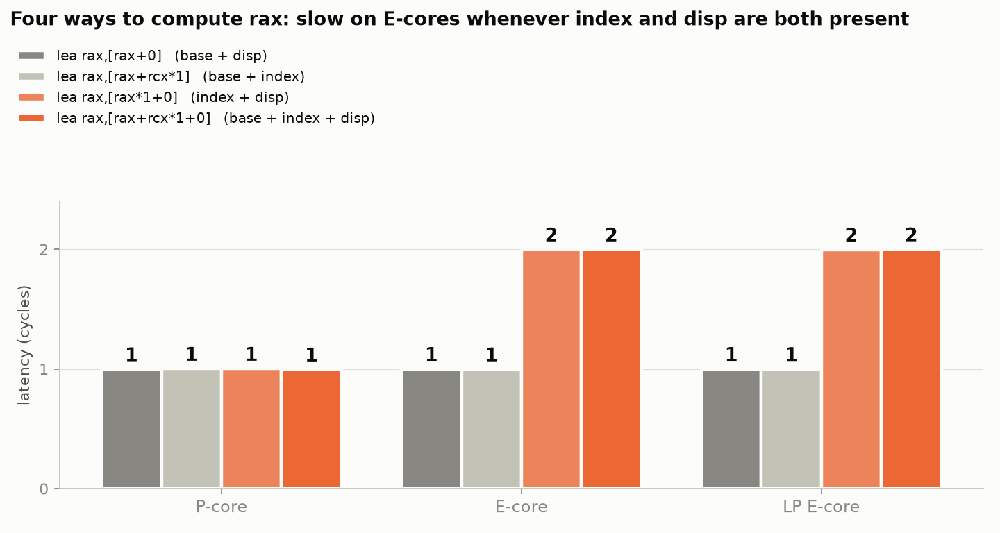

# Adding Zero to an LEA

**Are there different timings between the address modes of equivalent x86 instructions?**

Abby Xiong and Yunyi Chen · Carnegie Mellon University · October 2026

Yes, on some cores. On an Intel Core Ultra 9 285H (Arrow Lake), the E-cores take **2 cycles** for any
`lea` that has both an index register and a displacement, and 1 cycle for every other form, even when
the displacement is zero and the result is identical. The P-core on the same chip takes 1 cycle for
every form.

| latency (cycles) | P-core | E-core | LP E-core |
|---|---|---|---|
| `lea rax,[rax+rcx*1]` | 1 | 1 | 1 |
| `lea rax,[rax+rcx*1+0]` | 1 | **2** | **2** |



## Hypothesis

We hypothesize that the two core families build their address adder differently:

- **E-core: a 2-input adder.** The base takes one input; the index and the displacement share the
  other. Any two parts fit in one cycle, but an index together with a displacement needs a second step.
- **P-core: a 3-input adder.** A 3-to-2 compressor feeds one adder, so base + index + displacement
  finish in one cycle, with missing parts fed in as 0.

**Prediction:** on E-cores, equivalent addresses written in different modes cost differently: 2 cycles
whenever an index and a displacement occur together, 1 otherwise, whatever their values. On the P-core,
no difference.

## The test: every combination of base, index and displacement

Every instruction below computes exactly `rax` (`rcx` = 0, every displacement = 0).

| parts | instruction | P | E | LP-E |
|---|---|---|---|---|
| base | `[rax]` | 1 | 1 | 1 |
| base + disp | `[rax+0]` | 1 | 1 | 1 |
| base + index | `[rax+rcx*1]` | 1 | 1 | 1 |
| **index + disp** | `[rax*1+0]` | 1 | **2** | **2** |
| **base + index + disp** | `[rax+rcx*1+0]` | 1 | **2** | **2** |

The prediction holds. The slowdown is not about the number of parts: `[rax*1+0]` has only two and is
still slow. Index-only cannot be encoded (with no base, x86 always adds a 4-byte displacement), and a
displacement alone has no register input to chain.

Alternatives we ruled out:

| Could it be… | Test | Result |
|---|---|---|
| The displacement's value | disp = 0, 8, −8, 127, 4096 | all 2 cycles: presence matters |
| The index register's value | `rcx` = 1 vs 0 | no change |
| Instruction length | `[rax+0]` as disp32 (7 B) vs `[rax+rcx*1+0]` as disp8 (5 B) | the longer one is the fast one |
| The `*1` multiply | `[rax+rcx*1]` has the same ×1 | 1 cycle |
| Which input joins late | `[rax+rcx*1+0]` vs `[rcx+rax*1+0]` | both paths 2 cycles |
| "RBP-based LEA is slow" | `[rbp+rax*1]` needs a displacement byte | the same effect |
| Noise, clock, harness bugs | 2 CPUs per core type, per-run calibration, uops.info | within ±2%; matches uops.info |

Throughput also drops: 0.13 → 0.30 cycles per instruction on the E-core, 0.25 → 1.00 on the LP E-core.

## Method

- **Dependency chains.** Each `lea` feeds the next, so time ÷ count = latency. 200 instructions unrolled
  per loop, 200,000 iterations, median of 7 runs.
- **Exact bytes.** Encodings are written byte by byte (`.byte 48 8D 44 08 00`) and checked with
  `objdump`, because an assembler silently drops a `+0`.
- **One core at a time.** Each run is pinned with `SetThreadAffinityMask`; core type comes from
  `GetSystemCpuSetInformation` EfficiencyClass. P-core = CPUs 0,1,10–13, E-core = 2–9, LP E-core = 14,15.
- **Calibrated cycles.** rdtsc divided by an `add rax,rcx` chain (1 cycle) timed right before and after
  each kernel. `add rax,1` is **not** a valid reference on this CPU: it costs about 0.17 cycles because
  newer cores fold immediate adds at rename.
- **Native Windows, not WSL.** WSL2 exposes no hardware counters, can't pin to a core type, and showed
  about ±20% noise; native runs agree within ±2%.

## Wider survey

Before focusing on the zero displacement we ran the four planned experiments on all three core types
(figures in `results/`). Highlights:

- **LEA latency** (`fig_exp1_lea_latency.png`): the P-core pays a cycle for any scale factor (×2/×4/×8);
  the E-cores pay for index + displacement. Skylake's "3-part LEA = 3 cycles" holds on none of them.
- **Equivalent encodings** (`fig_exp3_equivalent.png`): splitting a slow LEA into two instructions
  doesn't help; moving the loop-invariant part off the dependency chain does (2 → 1 cycle).
- **Real loads** (`fig_exp4_lea_vs_load.png`): load-use latency is a flat 4 cycles on P and E whatever the
  addressing form, so LEA timing is not a proxy for memory-addressing cost.
- **Throughput** (`fig_exp2_lea_throughput.png`): on the E-core, scaled-index LEAs have 1-cycle latency
  but only 1 per cycle throughput.

All LEA latency and throughput values match [uops.info](https://uops.info) (ARL-P, ARL-E, MTL-E rows).

## AI use

The experiment plan was drafted with an LLM and carried outdated Skylake-era rules (`add rax,1` as a
1-cycle reference, "3-part LEA is slow"); sanity checks and uops.info caught both. The AI also explained
our result as "three address parts are slow". We didn't accept that and insisted on testing
index + displacement on its own; the two-part `[rax*1+0]` is still slow, which revealed the real rule.

## Limitations

- Cycles are rdtsc-calibrated, not read from a core-cycle counter (Windows has one via ETW, but it needs
  admin rights).
- Windows exposes no per-port or micro-op counters, so the adder model is inferred from timing. Timing
  can't tell whether the E-core's second step is a second micro-op or one 2-cycle micro-op.
- The LP E-core being Crestmont is inferred from its match with uops.info's Meteor Lake-E rows.

## Repository structure

```
.
├── README.md
├── docs/
│   └── x86 寻址模式时序实验方案.md   original experiment plan (Chinese)
├── harness/                         benchmark source
│   ├── gen.py                       defines every kernel; emits kernels.S / .h / .json
│   ├── bench.c                      driver: core pinning, rdtsc calibration, 7-run medians
│   ├── run_all.py                   build + run on chosen CPUs → results/*.csv
│   ├── plot.py                      figures → results/*.png
│   ├── relabel.py                   refresh CSV labels from kernels.json
│   ├── codegen.c                    gcc -march codegen test (Exp 3E)
│   ├── build_report.py              inline figures into the HTML report
│   ├── report_template.html         source of results/LEA_report.html
│   ├── build.ps1                    native Windows build
│   └── run.sh                       WSL/Linux build + run
├── results/
│   ├── zero_disp.csv                zero-displacement study (6 CPUs, 180 rows)
│   ├── results.csv                  Exp 0–4 on P / E / LP-E (216 rows)
│   ├── uops_info_reference.csv      reference values from uops.info
│   ├── raw/                         unprocessed per-CPU output
│   ├── codegen/                     gcc output per -march
│   ├── fig_*.png                    figures
│   ├── LEA_report.html              self-contained report (open in a browser)
│   ├── SUMMARY.md                   full write-up
│   └── TALK.md                      5-minute talk script
└── slides/                          source of the presentation deck
    ├── deck.json                    slide order and fonts
    └── slides/*.html                one file per slide (Claude Slides format)
```

## Reproduce

Windows, with [WinLibs](https://winlibs.com) gcc and Python 3 (`pip install matplotlib`), from `harness/`:

```bash
python run_all.py
python run_all.py --only=ez --out=zero_disp.csv 0:P 10:P 2:E 6:E 14:LP-E 15:LP-E
python plot.py
python build_report.py report_template.html ../results/LEA_report.html
```

The first command runs every experiment on CPUs 0, 2 and 14 (about 2 minutes); the second runs the
zero-displacement study on two CPUs of each core type. CPU numbers are specific to the 285H; run
`bench.exe list` to see each logical CPU's core type on another machine.
